<div align="center">

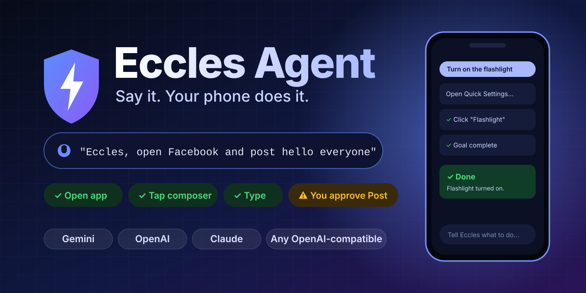

<br/>

[](#-install-in-60-seconds)
[](#-get-your-ai-api-key)
[](#-get-your-ai-api-key)
[](#-get-your-ai-api-key)
[](https://paystack.shop/pay/support-eccles-agent-tie1)
[](#-safety-is-not-a-feature-its-the-architecture)

### Tell your phone what to do. Watch it happen. Stop it with one tap.

**[❤️ Support this project](https://paystack.shop/pay/support-eccles-agent-tie1)** &nbsp;·&nbsp; **[⬇️ Download the APK](https://github.com/igwe-starking/eccles-agent/releases/latest)** &nbsp;·&nbsp; **[📲 Install (no computer needed)](#-install-in-60-seconds)** &nbsp;·&nbsp; **[🔑 Get an API key](#-get-your-ai-api-key)** &nbsp;·&nbsp; **[🎬 See it work](#-see-it-work)**

</div>

<p align="center"><a href="https://paystack.shop/pay/support-eccles-agent-tie1">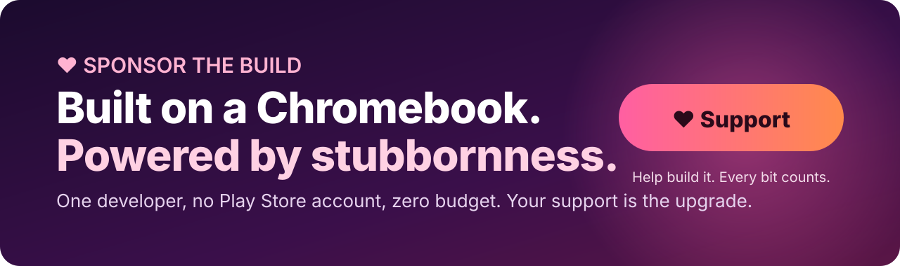</a></p>

---

## 🎬 See it work

<table>
<tr>
<td align="center" width="33%">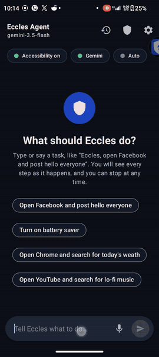<br/><b>"Turn on the flashlight"</b><br/><sub>Opens Quick Settings, finds the toggle, taps it.</sub></td>
<td align="center" width="33%">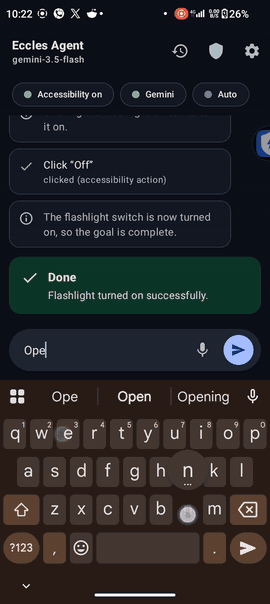<br/><b>"Open Facebook and post<br/>I love programming on red background"</b><br/><sub>Picks the background. Types. Asks you before it posts.</sub></td>
<td align="center" width="33%">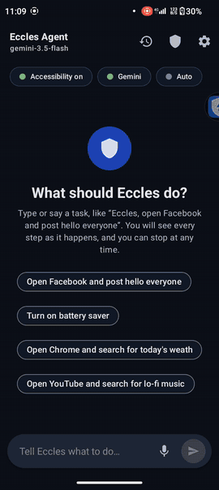<br/><b>The confirmation gate</b><br/><sub>Anything irreversible waits for your <code>Allow</code>. Silence means <code>Deny</code>.</sub></td>
</tr>
</table>

<details>
<summary><b>▶️ Full-length clips (MP4)</b></summary>

| Clip | What happens |
|---|---|
| [`flashlight.mp4`](docs/media/demo/flashlight.mp4) | Voice-style command to a system toggle, with the live timeline |
| [`facebook-red-post.mp4`](docs/media/demo/facebook-red-post.mp4) | Multi-step social post with a styled background |
| [`camera.mp4`](docs/media/demo/camera.mp4) | "Take a picture of my laptop. It's facing the rear camera." |
| [`confirmation-gate.mp4`](docs/media/demo/confirmation-gate.mp4) | The approval prompt before a post goes out |

</details>

And the picture it took when asked to photograph a laptop:

<p align="center">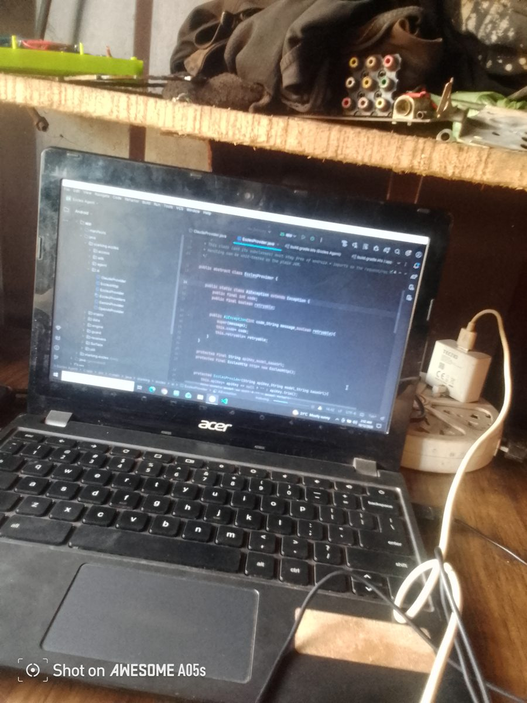</p>

<details>
<summary><b>🖼️ More screenshots</b></summary>

<p align="center">
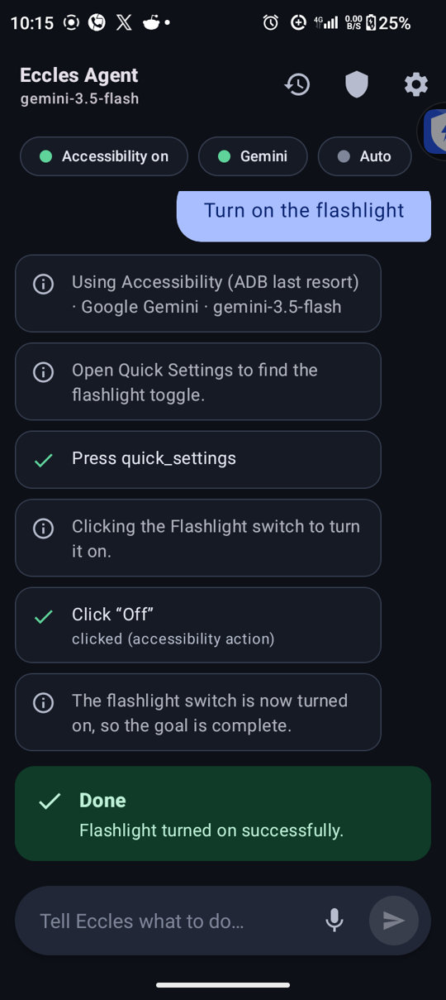
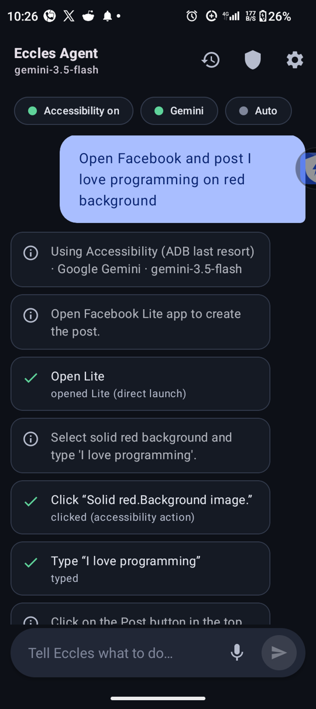
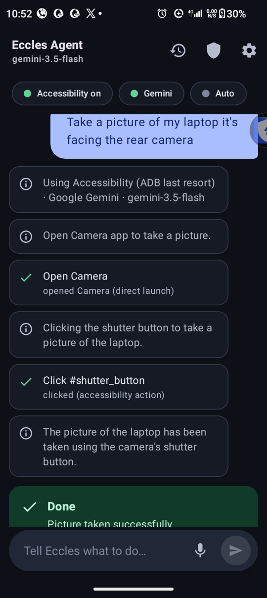
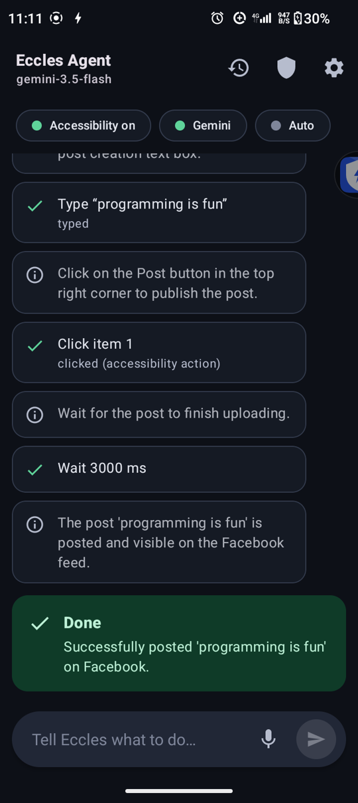
</p>

</details>

---

## ⚡ What is Eccles Agent?

Eccles Agent is an Android app that **operates your phone for you**. You type or speak a goal. Eccles reads the screen, asks an AI model what to do next, and carries out the answer with real taps, typing and swipes. It repeats until the job is done, and you watch every step in a live timeline.

```text
You    ▸ "Open Facebook and post I love programming on red background"

Eccles ▸ ✓ Open Lite                       opened (direct launch)
         ✓ Click "Solid red. Background"   clicked (accessibility action)
         ✓ Type "I love programming"       typed
         ⚠ Click "Post"                    waiting for your approval…   [ Deny ] [ Allow ]
         ✓ Done                            Posted.
```

No scripting. No per-app integrations. If a human can do it on screen, Eccles can try.

## 🧠 Why it's different

| | |
|---|---|
| 🗣️ **Plain-language control** | Type it or tap the mic. Starting with *"Eccles…"* runs immediately. |
| 🔌 **Bring your own brain** | Google **Gemini** (default), **OpenAI**, Anthropic **Claude**, or any **OpenAI-compatible** endpoint (OpenRouter, Groq, DeepSeek, local Ollama / LM Studio). Switch in Settings. |
| 🎯 **Acts like a user, verifies like an engineer** | Every action tries the accessibility node first and falls back to a real touch. A node action only counts if the UI reacted. If it did not, Eccles re-plans from a fresh screenshot instead of blindly retrying and double-tapping a "Like". |
| 🚀 **Opens apps reliably** | A verified four-step ladder: direct launch, service-context launch, drive the launcher like a user, then ADB `monkey`. Typo-tolerant app matching with "did you mean…" recovery. |
| 👁️ **Vision when it needs it** | Screenshots are sent only when the screen tree is not enough (or every step, or never; your choice). |
| 🛑 **Always stoppable** | Foreground service with a Stop action, plus a floating **Stop** pill on top of every app. |
| 🔐 **Keys stay on your device** | API keys are encrypted with an AndroidKeystore AES-GCM key. Never in plain preferences, never in a URL. |
| 🧪 **Tested core** | Parser, matching, safety rules, coordinate mapping, all three provider request shapes and the ADB wire protocol ship with a pure-JVM unit-test suite. |

---

## 📲 Install in 60 seconds

> ### ✅ You do **not** need a computer or ADB
> **Pick the route that fits you:**
>
> | | Route | You need | Best for |
> |---|---|---|---|
> | 🟢 **A** | **Phone only** (unlock "Restricted settings") | Just the phone, Android 8+ | Everyone. Start here. |
> | 🔵 **B** | **ADB from a computer** | A computer + USB cable | If route A's menu is missing, or you prefer a clean developer install |
>
> **Why is there a special step at all?** Eccles Agent works as an **Android Accessibility Service**. Android (and Google Play Protect) treat accessibility as sensitive, so when an app is installed from **another app** such as a browser or file manager, Android 13+ can **grey out the Accessibility toggle** ("Restricted setting"). Both routes below get past that, safely and on your terms.

### 🟢 Route A: phone only, no ADB, no computer

1. **Download** `EcclesAgent-1.0.apk` from the [latest release](https://github.com/igwe-starking/eccles-agent/releases/latest).
2. **Install it.** Open the file. If Android asks, allow your browser or file manager to **"Install unknown apps"**. If Play Protect shows a warning, tap **More details → Install anyway**.
3. **Open Eccles Agent** once.
4. Go to `Settings → Accessibility → Eccles Agent` and **try to turn it on**. On Android 13+ you will see a **"Restricted setting"** message. Tap **OK**. *(This step is what makes the unlock option appear in the next step.)*
5. Go to `Settings → Apps → Eccles Agent`, tap the **⋮ menu (top-right) → Allow restricted settings**, and confirm with your PIN, fingerprint or face.
6. Go back to `Settings → Accessibility → Eccles Agent` and switch it **On**. ✅

> 🧭 **On Android 12 or older** there is no restriction. Skip steps 4 and 5 and just enable the service.
> Menu names differ slightly between brands (Samsung, Xiaomi, Tecno, Infinix…), but the idea is the same: **Apps → Eccles Agent → ⋮ → Allow restricted settings.**

### 🔵 Route B: install with ADB from a computer

Installing from a computer with `adb install` is a developer install, so the Accessibility toggle works normally with no extra unlock. About a minute, once.

**You need:** a computer (Windows, macOS, Linux or Chromebook with Linux), a USB cable, and Android 8.0 or newer.

1. **Turn on USB debugging:** `Settings → About phone →` tap **Build number** 7 times → `Settings → System → Developer options →` enable **USB debugging**.
2. **Get ADB** ([Android platform-tools](https://developer.android.com/tools/releases/platform-tools), a small download from Google).
3. **Plug in the phone**, accept the *"Allow USB debugging?"* prompt, then run:

```bash
adb devices                          # your phone should be listed as "device"
adb install -r EcclesAgent-1.0.apk   # prints "Success"
```

4. **Open Eccles Agent**, then `Settings → Accessibility → Eccles Agent → On`.

### 🔐 Verify your download (optional but smart)

```bash
# SHA-256 of EcclesAgent-1.0.apk
fe84e3b8e594dc70241e51ff28a9e6d2c73f9ab265580985600847469ea9bd3d
```

<details>
<summary><b>Why isn't it on Google Play?</b></summary>

Google Play restricts accessibility services to accessibility use cases, and the author does not currently have a Play developer account. That is why releases are published here, with the full source open for you to read and a checksum to verify. 💖 [Sponsoring](#-sponsor-eccles-agent) helps change that.

</details>

---

## 🔑 Get your AI API key

Eccles needs an **API key** from the AI provider you choose: the key is what lets the app talk to the model. Pick **one**. Open Eccles → **Settings → Provider**, choose it, paste the key into **API key**, then tap **Test connection**.

> 💡 API usage is billed by the provider you pick, and free-tier availability and limits change. Check each provider's pricing page before you start.

| Provider | Create your key here | Notes |
|---|---|---|
| **Google Gemini** *(default)* | **[aistudio.google.com/apikey](https://aistudio.google.com/apikey)** | Google AI Studio offers a free tier, which makes it the easiest place to start. |
| **OpenAI** | **[platform.openai.com/api-keys](https://platform.openai.com/api-keys)** | Use the API Platform, not just ChatGPT. You may need to add billing first. |
| **Anthropic Claude** | **[platform.claude.com/settings/keys](https://platform.claude.com/settings/keys)** | Create it in the Claude Console. You may need to add credits first. |
| **Custom** *(OpenAI-compatible)* | see below | Any service that speaks the OpenAI chat-completions format. |

<details open>
<summary><b>🟦 Google Gemini</b></summary>

1. Open **[aistudio.google.com/apikey](https://aistudio.google.com/apikey)** and sign in with your Google account (accept the terms if asked).
2. Click **Create API key** and pick (or create) a Google Cloud project when asked.
3. **Copy the key.** Paste it into Eccles under **Provider → Google Gemini → API key**.

Default model in the app: `gemini-3.5-flash` (editable in Settings).
</details>

<details>
<summary><b>🟪 OpenAI</b></summary>

1. Open **[platform.openai.com/api-keys](https://platform.openai.com/api-keys)** and sign in.
2. If prompted, set up billing under the Platform's **Billing** page.
3. Click **Create new secret key**, name it (for example "Eccles Agent") and create it.
4. **Copy it immediately.** OpenAI shows the full key only once.
5. Paste it into Eccles under **Provider → OpenAI → API key**.

Default model in the app: `gpt-5.6-sol` (editable in Settings).
</details>

<details>
<summary><b>🟧 Anthropic Claude</b></summary>

1. Open **[platform.claude.com/settings/keys](https://platform.claude.com/settings/keys)** and sign in (or create an account).
2. If prompted, add credits under **Billing**.
3. Click **Create key**, give it a name, and create it.
4. **Copy it immediately.** The Console shows the full key (it starts with `sk-ant-`) only once.
5. Paste it into Eccles under **Provider → Anthropic Claude → API key**.

Default model in the app: `claude-sonnet-5-5` (editable in Settings).
</details>

<details>
<summary><b>⬛ Custom (OpenRouter, Groq, DeepSeek, Ollama, LM Studio…)</b></summary>

Choose **Custom (OpenAI-compatible)** in Settings, then fill in **Base URL**, **Model** and **API key** (the key is optional for local servers).

| Service | Create a key | Base URL |
|---|---|---|
| OpenRouter | [openrouter.ai/keys](https://openrouter.ai/keys) | `https://openrouter.ai/api/v1` |
| Groq | [console.groq.com/keys](https://console.groq.com/keys) | `https://api.groq.com/openai/v1` |
| DeepSeek | [platform.deepseek.com/api_keys](https://platform.deepseek.com/api_keys) | `https://api.deepseek.com/v1` |
| Ollama / LM Studio | no key needed | your server's `/v1` address |

Eccles appends `/chat/completions` for you. For screen understanding, pick a model that accepts images.
</details>

> 🔒 **Treat your key like a password.** Never paste it into a GitHub issue, a screenshot or a chat. If it leaks, delete it in the provider's console and create a new one.

---

## 🚦 First run

1. **Settings →** choose a provider and paste the API key → **Test connection**.
2. Enable **Eccles Agent** under Android's **Accessibility** settings (the setup card guides you).
3. Type or say a task. Try: *"Turn on the flashlight."*
4. Watch the timeline. Hit **Stop** (pill, notification or button) at any moment.

*Android 8–10 only:* allow screen capture once when the setup card asks, and choose **Entire screen**. On Android 11+ screenshots go through the accessibility service, so there is nothing more to grant.

---

## 🛡️ Safety is not a feature. It's the architecture.

An agent that can tap anything needs a hard "no" list and a human in the loop. Eccles is built around both.

| Layer | What it does |
|---|---|
| **Excluded apps** | One choke point (`EcclesGuard`) runs *before* the screen is read, *before* a screenshot, *again after* capture, and before **every** action. Nothing from an excluded app is read, captured or sent to the AI. It **fails closed**. |
| **Banking and payments off-limits** | Ships pre-seeded with well-known banking and payment apps, plus heuristics that catch the long tail (bank, wallet, pay, crypto…). You can add or remove apps from a searchable list. |
| **Password screens** | Password field contents never enter a snapshot. By default a task **stops** when a password field appears. |
| **Confirmation gate** | Send, post, delete, buy and anything the model flags `sensitive` need your explicit **Allow**. **No answer in 60 seconds = Deny.** |
| **Prompt-injection stance** | On-screen text is declared *untrusted data*; only *your* goal is followed. |
| **Always stoppable** | Foreground service + Stop notification action + floating Stop pill. |
| **Private history** | History keeps the goal, outcome and a short message. Never screen content. |

<p align="center">
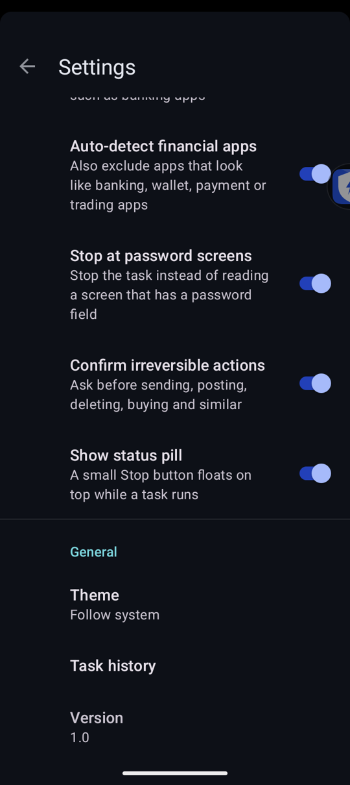&nbsp;&nbsp;
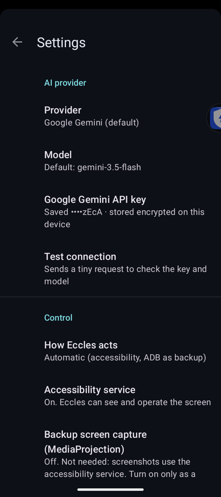&nbsp;&nbsp;
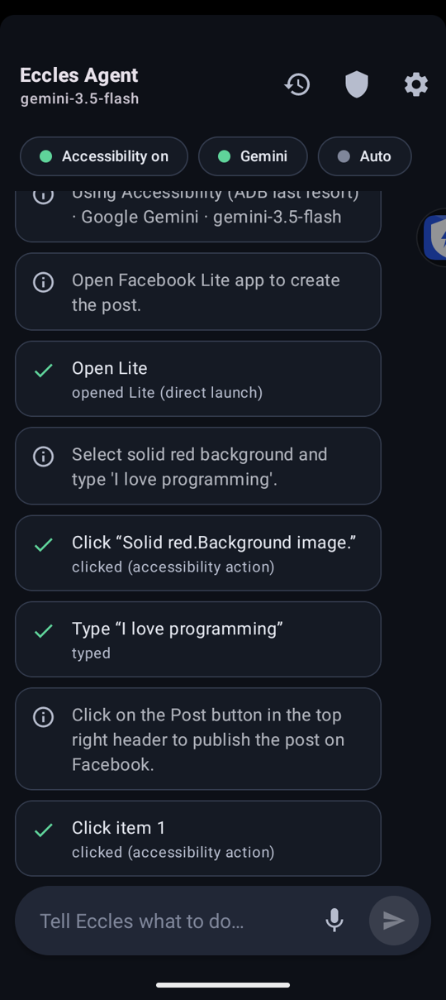
</p>

> **Be clear-eyed about privacy:** whatever is on screen during a task is sent to the AI provider *you* chose. That's why the excluded-apps guard runs first. Don't run tasks on screens you wouldn't want a cloud model to see.

---

## 🔧 How it works

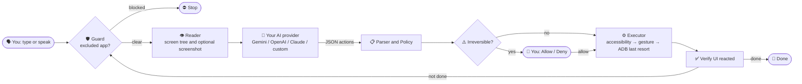

The model answers with one small JSON object per step:

```json
{
  "thought": "Facebook is open; the composer is item 7",
  "status": "continue",
  "need_vision": false,
  "actions": [
    {"type": "click", "target": {"index": 7, "text": "What's on your mind?"}},
    {"type": "type", "text": "hello everyone"}
  ]
}
```

`status` is `continue | done | failed | ask_user`. Actions: `open_app`, `click`, `tap`, `long_press`, `swipe`, `type`, `key`, `scroll`, `wait`. Anything that sends, posts, deletes or pays carries `"sensitive": true`.

Deep dive: [`docs/ENGINEERING_NOTES.md`](docs/ENGINEERING_NOTES.md).

---

## 🧱 Build from source

Requirements: JDK 17, Android SDK (API 34).

```bash
git clone https://github.com/igwe-starking/eccles-agent.git
cd eccles-agent
./gradlew testDebugUnitTest     # pure-JVM tests
./gradlew assembleDebug         # debug APK → app/build/outputs/apk/debug/
adb install -r app/build/outputs/apk/debug/app-debug.apk
```

Package `starking.eccles.*` · Java 11 · `minSdk 26` / `targetSdk 34` · Material 3 · zero third-party runtime dependencies beyond AndroidX and Material.

## 🧭 Honest limits

We would rather you hear it from us:

- **It can get things wrong.** It's an AI driving a UI. Watch the timeline, keep the Stop button in reach, and don't hand it anything you can't undo.
- **Some apps hide from accessibility**, and apps that mark windows secure return blank screenshots by design.
- **Android may refuse background launches.** Eccles verifies the app reached the foreground and reports failure so the AI can recover.
- **ADB fallback is optional and last-resort** (`adb tcpip 5555` once from a computer; resets on reboot). Wireless-debugging pairing is not implemented.
- **No always-on wake word yet.** Use the mic button or start a typed or spoken command with "Eccles".
- **Not on Google Play (yet).** Play restricts accessibility services to accessibility use cases, and the author has no Play developer account today.

Full list in [`docs/ENGINEERING_NOTES.md`](docs/ENGINEERING_NOTES.md#known-limits-read-before-relying-on-it).

## 🗺️ Roadmap

- [ ] Wireless-debugging (TLS + pairing) for the ADB fallback
- [ ] Always-on "Eccles" wake word
- [ ] Task templates and one-tap shortcuts
- [ ] Per-task cost and token readout
- [ ] More languages for the UI and the prompt

Ideas and votes welcome in [Issues](https://github.com/igwe-starking/eccles-agent/issues).

## 💖 Sponsor Eccles Agent

<p align="center"><a href="https://paystack.shop/pay/support-eccles-agent-tie1"></a></p>

**Eccles Agent is built by one developer, on a Chromebook that struggles to run Android Studio, with no Play Store account and no budget.** You have watched it flip switches, take photos and post for you in the clips above. That all happened on a shoestring. **Imagine it with real tools.**

If this project saved you time, taught you something, or just made you grin, please consider sponsoring. Every contribution goes straight into making it faster, safer and available to more people.

### 🎯 What your sponsorship unlocks

| Milestone | What it means for you |
|---|---|
| 💻 **A proper Android dev machine** | Builds in seconds instead of crawling. Faster fixes, faster releases. |
| 📱 **Test devices across Android versions** | Fewer "works on my phone" bugs. Real testing on more brands and versions. |
| 🏪 **A Google Play developer account** | One-tap installs for everyone (subject to Google's accessibility-policy review). |
| 🔑 **API credits for testing providers** | Gemini, OpenAI, Claude and custom endpoints all tested properly, every release. |
| 🚀 **Roadmap time** | Wake-word, wireless-debugging pairing, task templates (see the [roadmap](#-roadmap)). |

### 🎁 Sponsor perks *(draft tiers; final amounts are set on GitHub Sponsors)*

| Tier | Perk |
|---|---|
| ☕ **Supporter** | Your name in the README Sponsors wall |
| 🚀 **Backer** | Supporter perks + vote on what gets built next |
| 🛡️ **Champion** | Backer perks + early access to new APK builds + priority issue triage |
| 🏢 **Company sponsor** | Logo and link in the README + priority support |

### 💸 Ways to give

<p align="center">

## [💳 Give by card, bank transfer or USSD →](https://paystack.shop/pay/support-eccles-agent-tie1)

</p>

| Way | Status | Best for |
|---|---|---|
| 💳 **Paystack** (any amount, one time) | ✅ **Live now.** [Open the payment page](https://paystack.shop/pay/support-eccles-agent-tie1) | Anyone. Nigerian cards, bank transfer and USSD work today |
| 💵 **Direct USD transfer** (ACH / wire) | ✅ Available now. [Open a "Sponsor" issue](https://github.com/igwe-starking/eccles-agent/issues/new?template=sponsor.md) and the details will be sent to you | Companies and supporters abroad |
| ❤️ **GitHub Sponsors** (monthly) | 🔜 Application in review. The button goes live here the moment it's approved | Recurring support, worldwide |

> ℹ️ The Paystack checkout shows the merchant name **"Starking Cooperation"**. That's the project owner's payment account, so don't be alarmed. Payments are in Nigerian Naira (₦); overseas cards are converted by your bank.

> 🔒 Payment details are shared on request rather than posted publicly, to keep scammers and impersonators away. Only ever trust details that come from this repository's owner, `@igwe-starking`.

> **No money? You can still help massively:** ⭐ star the repo, share the demo videos, report bugs, or send a pull request. A star is free and it's how other people find this.

### 🙌 Sponsors

*Be the first name on this wall.* ✨

---

## 🤝 Contributing

Pull requests are welcome. See [CONTRIBUTING.md](CONTRIBUTING.md). Found a vulnerability? Please read [SECURITY.md](SECURITY.md) first.

## ⚖️ Disclaimer

Eccles Agent automates actions on your device using a third-party AI model you configure. You are responsible for the tasks you give it and for the API usage billed by your provider. It is provided "as is" under the license below. Don't use it to break any app's or service's terms.

## 📄 License

[MIT](LICENSE)

<div align="center">

Made with ☕ and stubbornness by **[Nwobodo Ecclesiastes Chidera](https://github.com/igwe-starking)** (`@igwe-starking`)

**If Eccles made you smile, ⭐ star the repo. It's how others find it.**

</div>
